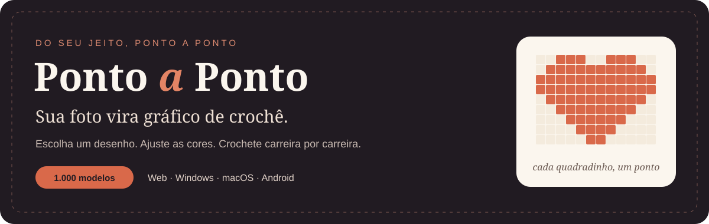
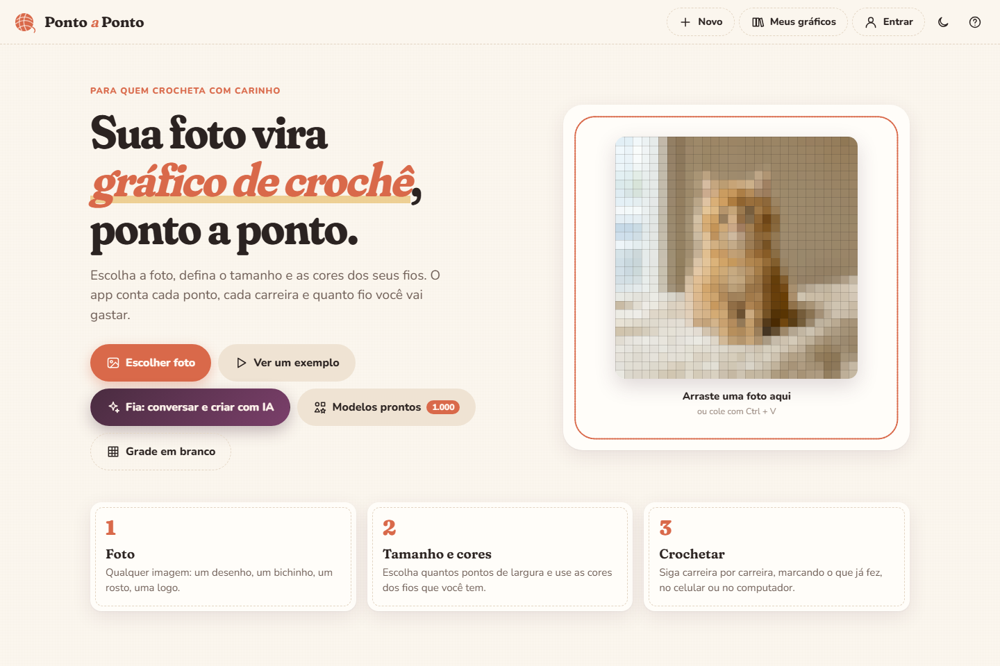
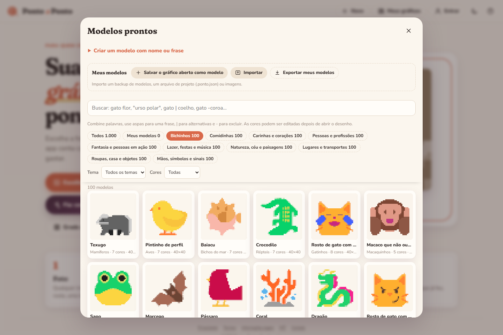
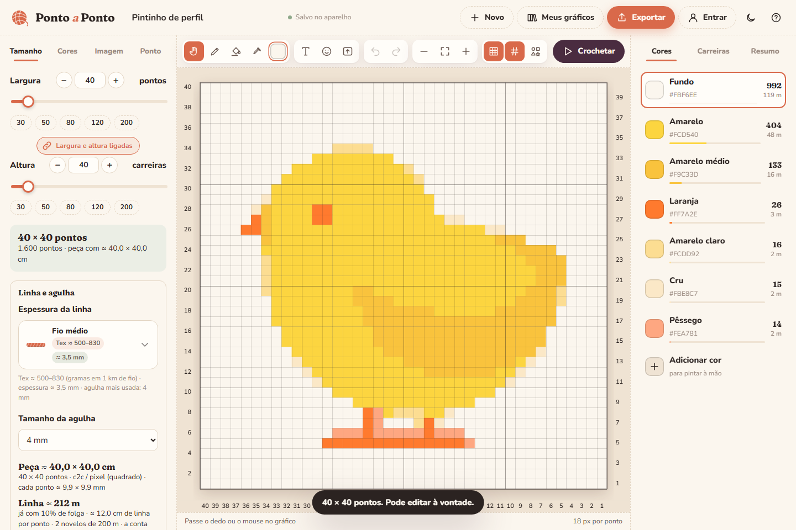

  
  

<b>Um ateliê de gráficos de crochê no seu aparelho.</b> Transforme fotos, escolha entre 1.000 desenhos e personalize cada cor antes de começar.

<a href="#comece-aqui">Comece aqui</a> · <a href="#o-que-você-pode-fazer">Recursos</a> · <a href="#baixe-para-seu-aparelho">Downloads</a> · <a href="#veja-por-dentro">Veja por dentro</a>

## Comece aqui

**[Abrir Ponto a Ponto →](https://pontoapontocroche.vercel.app/app/)**

1. Escolha uma foto, um modelo pronto ou uma grade em branco.
2. Ajuste tamanho, fios e cores. Confira a medida usando a sua amostra.
3. Ative **Crochetar** para acompanhar as carreiras ou exporte o gráfico.

O editor funciona sem cadastro. Entre com e-mail e senha quando quiser sincronizar seus gráficos ou conversar com a Fia pela internet.

## O que você pode fazer

| Para criar | Para crochetar |
|---|---|
| Converter uma foto em uma grade de pontos | Contar pontos e acompanhar cada carreira |
| Buscar entre **1.000 desenhos diferentes**, 100 em cada uma das 10 categorias | Calcular dimensões pela sua amostra |
| Editar as cores e montar nomes ou frases | Estimar fio, consultar Tex e agulha |
| Ajustar o modelo antes de abrir no editor | Exportar **PDF, PNG e projeto editável** |
| Criar, importar e exportar **os seus próprios modelos** | Ligar ou soltar largura e altura, com − / + e campo para digitar |
| Conversar com a **Fia**, com conta e conexão | Guardar projetos no aparelho e sincronizar na nuvem |

As cores são editáveis; variações de paleta não são contadas como novos desenhos. O editor e a biblioteca continuam disponíveis sem internet após o primeiro carregamento. As estimativas de tamanho e fio dependem da amostra e do material.

## Baixe para seu aparelho

| Seu aparelho | Instalação |
|---|---|
| **Windows 10/11 · 64 bits** | [Instalador](https://github.com/Bielicoman/pontoapontocroche/releases/latest/download/PontoAPonto-Windows.exe) · [Portátil](https://github.com/Bielicoman/pontoapontocroche/releases/latest/download/PontoAPonto-Windows-portatil.exe) |
| **Mac com chip Apple · macOS 12+** | [Baixar DMG para M1, M2, M3 e posteriores](https://github.com/Bielicoman/pontoapontocroche/releases/latest/download/PontoAPonto-Mac-arm64.dmg) |
| **Mac Intel · macOS 12+** | [Baixar DMG Intel](https://github.com/Bielicoman/pontoapontocroche/releases/latest/download/PontoAPonto-Mac-x64.dmg) |
| **Android** | [Baixar APK](https://github.com/Bielicoman/pontoapontocroche/releases/latest/download/PontoAPonto-Android.apk) |
| **iPhone e iPad** | [Abrir no Safari](https://pontoapontocroche.vercel.app/app/) → Compartilhar → Adicionar à Tela de Início |
| **Qualquer computador** | [Usar no navegador](https://pontoapontocroche.vercel.app/app/) |

No Mac, use **Ajustes do Sistema → Privacidade e Segurança** para permitir a primeira abertura, caso seja solicitado. Os aplicativos de computador ainda não possuem certificado comercial de distribuição.

A Fia online conversa e cria imagens por modelos de IA gratuitos: Z-Image-Turbo no Hugging Face e, quando disponível, fila comunitária do AI Horde. Há cotas, filas e possíveis interrupções; nenhum plano pago é acionado automaticamente. Conta e internet são necessárias. Novo chat e histórico permitem retomar ou apagar conversas salvas neste aparelho. Os pedidos online passam por Vercel/Groq e pelos provedores de imagem; a sincronização de projetos usa Firebase. A opção de IA local nos instaladores de computador depende de baixar modelos.

## Novidades da versão 1.1.3

- **1.000 modelos prontos refeitos**, 100 em cada categoria: Bichinhos, Comidinhas, Carinhas e corações, Pessoas e profissões, Fantasia e pessoas em ação, Lazer, festas e música, Natureza, céu e paisagens, Lugares e transportes, Roupas, casa e objetos, e Mãos, símbolos e sinais. Desenhos do Fluent Emoji da Microsoft (licença MIT), convertidos em gráficos de 40 × 40 pontos, com nomes e palavras de busca em português.
- **Meus modelos:** salve o gráfico aberto como modelo, importe um backup, um arquivo de projeto ou imagens, e exporte os seus modelos.
- **Controles mais precisos:** botões − e + e campo para digitar em todos os sliders e números; largura e altura na mesma escala.
- **Link entre largura e altura** (e entre pontos e carreiras da amostra): ligado, uma medida acompanha a outra; solto, cada uma muda sozinha.
- **Voltar ao padrão** em cada aba (Tamanho, Cores, Imagem e Ponto).
- **Fia mais confiável sobre o app:** responde dúvidas de uso só com o guia real das telas e botões, sem inventar funções.
- Correções: a barra de busca dos modelos não deixa mais os desenhos aparecerem por cima ao rolar, e os avisos com "Desfazer" aparecem por cima das janelas abertas.

## Novidades da versão 1.1.2

- Cor do texto com seletor livre e cores da paleta, prévia imediata e aplicação no gráfico.
- Fia com novo chat, histórico local, continuação de conversas e exclusão.
- Imagens online gratuitas com estilos definidos: Para gráfico, Ilustração, Amigurumi e Livre. A opção 3D simples usa composições limitadas.
- Documentação de privacidade, termos, IA, direitos, segurança, MIT e créditos, disponível no site e dentro dos apps.
- Primeira abertura no computador com acesso à Fia online sem baixar os modelos locais. IA online requer conta e internet e está sujeita a cotas e filas.

## Veja por dentro

### Um ponto de partida simples

### Uma biblioteca para explorar

### Seu gráfico, suas cores

## Ajuda e novidades

- [Site e instruções de instalação](https://pontoapontocroche.vercel.app/)
- [Última versão e histórico de downloads](https://github.com/Bielicoman/pontoapontocroche/releases)
- [Relatar um problema](https://github.com/Bielicoman/pontoapontocroche/issues/new/choose)

Criado por Alex Ascencio · Bielicoman

## Desenvolvimento

O código-fonte está organizado em `web/`, `api/`, `lib/`, `desktop/`, `android/` e `tools/`. Consulte o [guia de desenvolvimento e publicação](docs/DEVELOPMENT.md) para comandos, arquitetura, IA local e verificações. Os instaladores públicos ficam em um repositório separado.

## Transparência e licença

O código e a documentação originais são disponibilizados sob a [licença MIT](LICENSE), preservados os direitos de terceiros. Consulte a [central de transparência](https://pontoapontocroche.vercel.app/app/legal/), com privacidade, termos, armazenamento, uso de IA, direitos e exclusão de dados, segurança e créditos.

Contato: [ascencioalexgabriel@gmail.com](mailto:ascencioalexgabriel@gmail.com).
